# Especificação de Novas Técnicas de Cálculo Mental — Auramath

> **Metáfora Central**: *"Não calcule. Veja."*  
> Este documento detalha a taxonomia, as propriedades algébricas, os algoritmos geradores e os contratos de interface das 14 novas técnicas de cálculo mental catalogadas para expansão do motor `@auramath/engine` e enriquecimento da Trilha e do modo *Olho Matemático*.

---

## 1. Visão Geral da Expansão Curricular

As técnicas são divididas em 6 famílias cognitivas, desenhadas para reduzir a carga na memória de trabalho (*working memory load*) e substituir algoritmos mecânicos de papel e lápis por reconhecimento perceptual imediato.

```mermaid
graph TD
    A["Novas Técnicas de Cálculo Mental"] --> B["Família 1: Simetria & Base"]
    A --> C["Família 2: Dimediação & Divisão"]
    A --> D["Família 3: Percepção Relâmpago"]
    A --> E["Família 4: Trachtenberg & Múltiplos"]
    A --> F["Família 5: Frações & Finanças"]
    A --> G["Família 6: Auditoria & Verificação"]

    B --> B1["Antyayoreva (Dezenas Iguais, Unidades = 10)"]
    B --> B2["Pivô 50 (Quadrados Próximos de 50)"]
    B --> B3["Yavadunam (Bases Próximas de 100)"]

    C --> C1["Divisão por 5 (Dobrar e Deslocar)"]
    C --> C2["Divisão por 25 (Quadruplicar e Deslocar)"]
    C --> C3["Divisão por 4 (Bisseção Dupla)"]

    D --> D1["Raiz Cúbica Instantânea (até 1.000.000)"]
    D --> D2["Aproximação de Raiz Quadrada (Heron)"]

    E --> E1["Multiplicação por 12 (Trachtenberg)"]
    E --> E2["Multiplicação por 9 e 99 (Complemento Direto)"]

    F --> F1["Método da Borboleta (Soma de Frações)"]
    F --> F2["Frações Notáveis de Porcentagem"]
    F --> F3["Regra dos 72 (Juros Compostos)"]

    G --> G1["Prova dos 9 (Casting Out Nines)"]
```



---

## 2. Detalhamento Algébrico e Pedagógico por Família

### Família 1: Simetria & Truques de Base

#### 1.1. `ANTYAYOREVA` — Dezenas Iguais e Unidades que Somam 10
* **Grau Sugerido**: Grau III (Álgebra & Simetria)
* **Condição**: Sejam dois números de dois dígitos $(10a + b)$ e $(10a + c)$ onde $b + c = 10$.
* **Demonstração Algébrica**:
  $$(10a + b)(10a + c) = 100a^2 + 10a(b + c) + bc$$
  Como $b + c = 10$:
  $$100a^2 + 10a(10) + bc = 100a^2 + 100a + bc = 100a(a + 1) + bc$$
* **Regra Prática**:
  1. Prefixo: multiplique a dezena $a$ pelo seu sucessor $(a + 1)$.
  2. Sufixo: multiplique as unidades $b \times c$ (preenchendo 2 dígitos).
* **Exemplos**:
  - $43 \times 47$: $4 \times 5 = 20$, $3 \times 7 = 21 \rightarrow \mathbf{2021}$.
  - $84 \times 86$: $8 \times 9 = 72$, $4 \times 6 = 24 \rightarrow \mathbf{7224}$.
  - $71 \times 79$: $7 \times 8 = 56$, $1 \times 9 = 09 \rightarrow \mathbf{5609}$.
* **Template de Scaffolding**:
  - `template: "{tens} x {succ} = {p1} | {u1} x {u2} = {p2} -> {answer}"`

---

#### 1.2. `SQUARES_NEAR_50` — Quadrados Próximos de 50 (O Pivô 25)
* **Grau Sugerido**: Grau III (Álgebra & Simetria)
* **Condição**: Quadrado de um número na faixa $[41, 59]$. Seja $n = 50 + d$, com $d \in [-9, 9]$.
* **Demonstração Algébrica**:
  $$(50 + d)^2 = 2500 + 100d + d^2 = 100(25 + d) + d^2$$
* **Regra Prática**:
  1. Parte 1 (centenas): Some o desvio a 25: $(25 + d)$.
  2. Parte 2 (unidades/dezenas): Eleve o desvio ao quadrado: $d^2$ (2 dígitos).
* **Exemplos**:
  - $54^2$: $d = +4 \rightarrow 25 + 4 = 29$, $4^2 = 16 \rightarrow \mathbf{2916}$.
  - $47^2$: $d = -3 \rightarrow 25 - 3 = 22$, $(-3)^2 = 09 \rightarrow \mathbf{2209}$.
  - $57^2$: $d = +7 \rightarrow 25 + 7 = 32$, $7^2 = 49 \rightarrow \mathbf{3249}$.
* **Template de Scaffolding**:
  - `template: "50 + ({d}): 25 + ({d}) = {p1} | ({d})^2 = {p2} -> {answer}"`

---

#### 1.3. `YAVADUNAM_BASE_100` — Multiplicação em Torno da Base 100
* **Grau Sugerido**: Grau II ou III
* **Condição**: Multiplicação de dois fatores próximos a 100: $(100 + a)(100 + b)$.
* **Demonstração Algébrica**:
  $$(100 + a)(100 + b) = 10000 + 100(a + b) + ab = 100(100 + a + b) + ab$$
* **Regra Prática**:
  - Se ambos $> 100$: Adicione o desvio de um ao outro: $104 + 7 = 111$. Anexe $4 \times 7 = 28 \rightarrow \mathbf{11128}$.
  - Se ambos $< 100$: $96 \times 93$ ($a = -4, b = -7$). $96 - 7 = 89$. Anexe $(-4) \times (-7) = 28 \rightarrow \mathbf{8928}$.
* **Template de Scaffolding**:
  - `template: "100 + {a} + {b} = {base} | {a} x {b} = {tail} -> {answer}"`

---

### Família 2: Dimediação & Divisão Acelerada

#### 2.1. `DIV_5` — Divisão Rápida por 5
* **Grau Sugerido**: Grau II
* **Propriedade**: $\frac{n}{5} = \frac{n \times 2}{10}$.
* **Regra**: Dobre o número e desloque o separador decimal uma casa para a esquerda.
* **Exemplo**: $431 \div 5 \rightarrow 431 \times 2 = 862 \rightarrow \mathbf{86,2}$.

#### 2.2. `DIV_25` — Divisão Rápida por 25
* **Grau Sugerido**: Grau II
* **Propriedade**: $\frac{n}{25} = \frac{n \times 4}{100}$.
* **Regra**: Dobre duas vezes consecutivas e ande duas casas decimais para a esquerda.
* **Exemplo**: $140 \div 25 \rightarrow 140 \rightarrow 280 \rightarrow 560 \rightarrow \mathbf{5,6}$.

#### 2.3. `DIV_4` — Bisseção Dupla (Divisão por 4)
* **Grau Sugerido**: Grau I
* **Propriedade**: $\frac{n}{4} = \frac{n / 2}{2}$.
* **Regra**: Corte na metade duas vezes seguidas.
* **Exemplo**: $684 \div 4 \rightarrow 342 \rightarrow \mathbf{171}$.

---

### Família 3: Percepção Relâmpago ("Matemágica")

#### 3.1. `CUBE_ROOT_PERFECT` — Extração de Raiz Cúbica Instantânea
* **Grau Sugerido**: Grau IV (Fermi & Percepção)
* **Condição**: Quadrado/Cubo perfeito de número de 2 dígitos ($10 \le x \le 99$). $1.000 \le x^3 \le 970.299$.
* **Fundamento Matemático (Bijeção Módulo 10)**:
  | Dígito $x$ | Terminação $x^3 \pmod{10}$ |
  |:---:|:---:|
  | **0** | **0** |
  | **1** | **1** |
  | **2** | **8** *(complemento de 10)* |
  | **3** | **7** *(complemento de 10)* |
  | **4** | **4** |
  | **5** | **5** |
  | **6** | **6** |
  | **7** | **3** *(complemento de 10)* |
  | **8** | **2** *(complemento de 10)* |
  | **9** | **9** |
* **Algoritmo**:
  1. O último dígito determina unicamente o algarismo das unidades da raiz.
  2. Descarte os 3 últimos dígitos da direita.
  3. Com o número restante, encontre o maior cubo perfeito $\le$ a esse número para determinar as dezenas.
* **Exemplo**: $\sqrt[3]{175.616}$
  - Termina em **6** $\rightarrow$ unidade é **6**.
  - Resto ignorando os 3 últimos (`616`): **175**.
  - Cubos: $5^3 = 125$, $6^3 = 216$. O maior cubo $\le 175$ é $5^3$.
  - Resposta: **56** (resolvido em menos de 2 segundos!).

---

#### 3.2. `HERON_SQRT_APPROX` — Estimativa de Raiz Quadrada Não-Exata
* **Grau Sugerido**: Grau IV
* **Fórmula de Linearização**:
  $$\sqrt{S} = \sqrt{a^2 + b} \approx a + \frac{b}{2a}$$
* **Exemplo**: $\sqrt{39}$
  - Maior quadrado perfeito próximo: $6^2 = 36$, com sobra $b = 3$.
  - $\sqrt{39} \approx 6 + \frac{3}{2 \times 6} = 6 + \frac{3}{12} = 6 + 0,25 = \mathbf{6,25}$ (valor real: $6,2449$).

---

### Família 4: Sistema Trachtenberg & Múltiplos Notáveis

#### 4.1. `TRACHTENBERG_12` — Multiplicação por 12
* **Regra**: *"Dobre cada dígito e adicione o vizinho da direita."*
* **Exemplo**: $324 \times 12$
  - Passo 1: $4 \times 2 = \mathbf{8}$
  - Passo 2: $2 \times 2 + 4 = \mathbf{8}$
  - Passo 3: $3 \times 2 + 2 = \mathbf{8}$
  - Passo 4: $0 \times 2 + 3 = \mathbf{3}$
  - Resultado: $\mathbf{3888}$.

#### 4.2. `MULT_9_99` — Multiplicação por 9 e 99 (Complemento Direto)
* **Regra**:
  - $n \times 9 = 10n - n$
  - $n \times 99 = 100n - n$
* **Exemplo**: $64 \times 99 = 6400 - 64 = \mathbf{6336}$.

---

### Família 5: Frações & Finanças Práticas

#### 5.1. `BUTTERFLY_FRACTIONS` — Adição de Frações pelo Método da Borboleta
* **Fórmula**: $\frac{a}{b} + \frac{c}{d} = \frac{ad + bc}{bd}$.
* **Visualização no App**: O mascote Aura desenha as duas asas cruzadas da borboleta multiplicando os termos, e o corpo com o produto dos denominadores.

#### 5.2. `RULE_OF_72` — Regra dos 72 (Juros Compostos e Dobramento)
* **Fórmula**: $\text{Tempo para duplicar (anos)} \approx \frac{72}{\text{taxa percentual anual}}$.
* **Exemplo**: Um fundo rende $12\%$ ao ano. Tempo para dobrar: $72 \div 12 = \mathbf{6\text{ anos}}$.

---

### Família 6: Auditoria & Verificação Anti-Erro

#### 6.1. `CASTING_OUT_NINES` — Prova dos Noves (Aritmética Modular mod 9)
* **Propriedade**: Todo número inteiro é congruente à soma dos seus algarismos módulo 9.
* **Uso Pedagógico**: Em lições do Grau VI, o aluno valida produtos de alta complexidade sem recalcular, conferindo a consistência da operação em um único passo visual.

---

## 3. Plano de Integração no Código (`@auramath/engine`)

### 3.1. Novos IDs de Técnicas para a Engine
```typescript
export type ExtendedTechniqueId =
  | 'ADD_LEFT_RIGHT'
  | 'SUB_COMPENSATION'
  | 'COMPLEMENT_100'
  | 'MULT_5_50'
  | 'MULT_25'
  | 'MULT_11'
  | 'DIFF_OF_SQUARES'
  | 'SQUARES_ENDING_5'
  | 'FERMI_MAGNITUDE'
  | 'VEDIC_CROSS'
  | 'FLASH_ANZAN_MASTERY'
  // --- Novas Técnicas ---
  | 'ANTYAYOREVA'
  | 'SQUARES_NEAR_50'
  | 'YAVADUNAM_BASE_100'
  | 'DIV_5'
  | 'DIV_25'
  | 'DIV_4'
  | 'CUBE_ROOT_PERFECT'
  | 'HERON_SQRT_APPROX'
  | 'TRACHTENBERG_12'
  | 'MULT_9_99'
  | 'BUTTERFLY_FRACTIONS'
  | 'RULE_OF_72'
  | 'CASTING_OUT_NINES';
```

### 3.2. Contrato de Assinatura do Gerador no Engine
```typescript
export interface ProceduralGenerator {
  generateQuestion(technique: ExtendedTechniqueId, difficulty?: 'easy' | 'medium' | 'hard'): Question;
  generateScaffolding(technique: ExtendedTechniqueId): ScaffoldingTask[];
  generatePatternOption(technique: ExtendedTechniqueId): PatternOption[];
}
```
