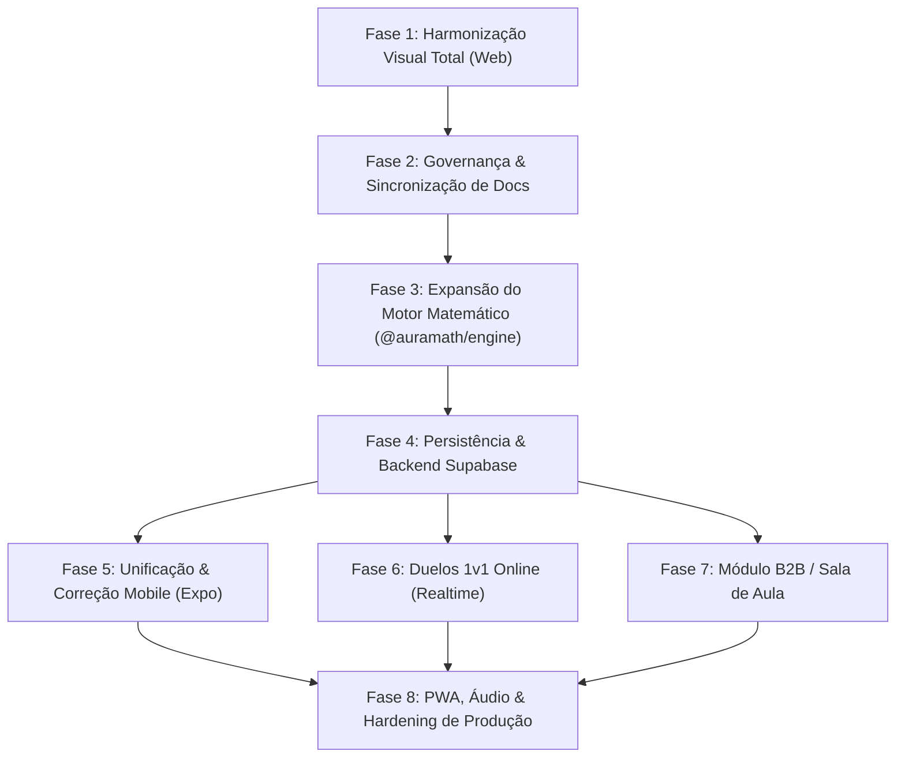

# Roteiro de Implementação e Conclusão — Auramath

Este documento estabelece o roteiro técnico, sequencial e priorizado para transformar o estado atual do **Auramath** em uma plataforma completa, integrada e pronta para produção, abrangendo frontend editorial, expansão de cálculo mental, persistência em nuvem, mobile nativo, multiplayer em tempo real e módulo escolar B2B.

---

---

## Fase 1: Harmonização Visual Total & Eliminação de Neons Residuais (Web)

> **Objetivo**: Concluir 100% da transição estética para o *Caderno Editorial de Descoberta*, eliminando os fundos cósmicos (`#0B0F19`, `#07090E`) e cores neon (`#00F2FE`, `#8A2BE2`) em telas secundárias da Web.

### Tarefas
- [x] **1.1. Refatorar [`src/views/DuelHubView.tsx`](file:///c:/Users/Pichau/Desktop/Projetos/auramath/src/views/DuelHubView.tsx)**:
  - Substituir o seletor escuro de modos por pílulas táteis em `Cream` e `Verdigris`.
  - Converter painéis de batalha 2P (*split-screen*) e *Shadow Racing* para cartões com bordas prensadas e tipografia tabular.
  - Integrar os botões táteis `.aura-3d-btn`.
- [x] **1.2. Refatorar [`src/views/LabView.tsx`](file:///c:/Users/Pichau/Desktop/Projetos/auramath/src/views/LabView.tsx)**:
  - Transformar o canvas do produto notável $(a+b)^2$ em uma folha de laboratório milimetrada (`.caderno-track-background`).
  - Utilizar a cor `Iris` (`#6E5AA6`) e `Verdigris` (`#176B5B`) para demarcar os blocos geométricos $a^2$, $ab$ e $b^2$.
- [x] **1.3. Harmonizar Subtelas de Jogo Específicas**:
  - Ajustar [`ArenaView.tsx`](file:///c:/Users/Pichau/Desktop/Projetos/auramath/src/views/ArenaView.tsx), [`BossBattleView.tsx`](file:///c:/Users/Pichau/Desktop/Projetos/auramath/src/views/BossBattleView.tsx), [`DailyChallengeView.tsx`](file:///c:/Users/Pichau/Desktop/Projetos/auramath/src/views/DailyChallengeView.tsx) e [`FlashAnzanView.tsx`](file:///c:/Users/Pichau/Desktop/Projetos/auramath/src/views/FlashAnzanView.tsx) para utilizarem as variáveis CSS de `--color-bg-base`, `--color-bg-surface` e `--color-text-primary`.
- [x] **1.4. Testes de Regressão Visual e Contraste**:
  - Criar suíte de testes `test/e2e/r7-views-theming-harmony.test.mjs` validando que nenhum arquivo em `src/views` contenha `#00F2FE`, `#07090E` ou `#0B0F19`.

---

## Fase 2: Governança e Sincronização da Documentação

> **Objetivo**: Deixar a documentação normativa do projeto rigorosamente alinhada com o código implementado.

### Tarefas
- [x] **2.1. Atualizar [`PROJECT.md`](file:///c:/Users/Pichau/Desktop/Projetos/auramath/PROJECT.md)**:
  - Marcar marcos **M4** (*Living Notebook Track & Nodes*) e **M5** (*Exercise, Feedback & Victory Screens*) como `DONE`.
  - Descrever os novos componentes do Figma (`src/components/editorial/`) como parte oficial do Design System.
  - Atualizar a contagem da suíte de testes para 183+ testes.
- [x] **2.2. Atualizar [`openspec/specs/ui-design-system/spec.md`](file:///c:/Users/Pichau/Desktop/Projetos/auramath/openspec/specs/ui-design-system/spec.md)**:
  - Substituir os requisitos do antigo tema "Dark Glassmorphism Bioluminescente" pelas especificações normativas do Rebrand Editorial 01.1 (*Paper*, *Nanquim*, *Verdigris*, 3D sink com 0ms de latência, semântica não-punitiva).
- [x] **2.3. Atualizar [`TEST_READY.md`](file:///c:/Users/Pichau/Desktop/Projetos/auramath/TEST_READY.md)**:
  - Atualizar os números da matriz de testes (de 69 para 183 testes) e registrar as novas suítes de teste de componentes editoriais.

---

## Fase 3: Expansão do Motor Matemático (`@auramath/engine`) e da Trilha

> **Objetivo**: Concluir os geradores procedurais das técnicas pendentes e incorporar todos os novos métodos na Trilha Curricular (`TRACK_GRADES`).

### Tarefas
- [x] **3.1. Correção do Drill de Lições (`DuolingoLessonView.tsx`)**:
  - Passar `node.id` para `generateQuestion` em vez do friendly name `node.technique`, garantindo que o drill gere as questões da técnica exata da lição.
- [x] **3.2. Geradores Procedurais das Técnicas Atuais Pendentes**:
  - Implementar gerador para `COMPLEMENT_100` (Sutra de Nikhilam / Base 100/1000).
  - Implementar gerador para `SQUARES_ENDING_5` (Ekadhikena Purvena).
  - Implementar gerador para `VEDIC_CROSS` (Urdhva-Tiryagbhyam $2 \times 2$).
  - Isolar geradores de `MULT_11`, `MULT_25` e `MULT_5_50`.
- [x] **3.3. Incorporar Novas Técnicas de Alto Impacto**:
  - Implementar gerador de `ANTYAYOREVA` (Dezenas Iguais e Unidades que somam 10).
  - Implementar gerador de `SQUARES_NEAR_50` (Pivô 25).
  - Implementar gerador de `YAVADUNAM_BASE_100` (Bases Próximas de 100).
  - Implementar gerador de `CUBE_ROOT_PERFECT` (Raiz Cúbica Instantânea até 1.000.000).
  - Implementar geradores de `DIV_5`, `DIV_25` e `DIV_4`.
  - Implementar geradores de `TRACHTENBERG_12`, `MULT_9_99` e `RULE_OF_72`.
- [x] **3.4. Cadastrar Todos os Métodos na Trilha de Aprendizado (`TRACK_GRADES`)**:
  - Expandir `TRACK_GRADES` de 11 para 21 nós completos, com teoria visual, fórmulas e andaimes (*scaffolding*) de preenchimento de lacunas.

---

## Fase 4: Camada de Persistência & Integração Supabase

> **Objetivo**: Conectar a aplicação ao banco de dados relacional e implementar persistência real de perfil, progresso e cosméticos com estratégia *offline-first*.

### Tarefas
- [ ] **4.1. Configuração do Cliente Supabase**:
  - Instalar dependência `@supabase/supabase-js`.
  - Criar `src/services/supabaseClient.ts` com suporte a variáveis de ambiente (`VITE_SUPABASE_URL`, `VITE_SUPABASE_ANON_KEY`).
  - Configurar tipagem do banco gerada a partir de [`supabase/migrations/20260908000000_auramath_schema.sql`](file:///c:/Users/Pichau/Desktop/Projetos/auramath/supabase/migrations/20260908000000_auramath_schema.sql).
- [ ] **4.2. Serviço de Autenticação (`src/services/authService.ts`)**:
  - Implementar métodos de cadastro, login por email/senha, login anônimo (para início imediato do aluno sem fricção) e logout.
  - Modal editorial de login/cadastro (`src/components/tactile/AuthModal.tsx`).
- [ ] **4.3. Repositório Offline-First e Sincronização Delta**:
  - Criar `src/services/storageService.ts` usando IndexedDB (`idb` ou `localStorage` robusto) como camada primária de leitura e escrita imediata (zero latência).
  - Implementar fila de mutações (*sync queue*): ao concluir lições ou ganhar estrelas offline, as ações são enfileiradas e despachadas para o Supabase quando a conexão estiver ativa.
- [ ] **4.4. Vinculação do Estado Global**:
  - Conectar `App.tsx` e `ProfileHubView.tsx` ao serviço de persistência, carregando XP real, estrelas, histórico de streak e selos de maestria desbloqueados (`user_unlocked_badges`).

---

## Fase 5: Estabilização e Sincronização do App Mobile (`apps/mobile` - Expo)

> **Objetivo**: Corrigir as dependências do app mobile nativo e portar os novos componentes táteis editoriais para React Native.

### Tarefas
- [ ] **5.1. Resolução de Tipos e Build do Monorepo**:
  - Ajustar `apps/mobile/tsconfig.json` para delimitar `types` e `typeRoots`, sanando erros de resolução de definições externas (`cookie`, `graceful-fs`, `jest`).
  - Validar execução limpa de `npx tsc -p apps/mobile/tsconfig.json --noEmit`.
- [ ] **5.2. Port dos Componentes Táteis para React Native**:
  - Criar versões React Native do `TrackSerpentineNode` e botões táteis 3D com `react-native-reanimated` e `expo-haptics` (vibração tátil física ao pressionar botões).
  - Atualizar [`apps/mobile/app/(tabs)/index.tsx`](file:///c:/Users/Pichau/Desktop/Projetos/auramath/apps/mobile/app/%28tabs%29/index.tsx) e [`apps/mobile/app/lesson/[nodeId].tsx`](file:///c:/Users/Pichau/Desktop/Projetos/auramath/apps/mobile/app/lesson/%5BnodeId%5D.tsx) com a paleta de papel e o novo mascote Aura.
- [ ] **5.3. Testes em Emulador**:
  - Testar execução do Expo via `npm run --workspace=@auramath/mobile start`.

---

## Fase 6: Duelos Síncronos 1v1 Online (Supabase Realtime)

> **Objetivo**: Habilitar competição síncrona online entre dois jogadores reais através de WebSockets.

### Tarefas
- [ ] **6.1. Protocolo Determinístico de Partida**:
  - Criar `src/services/matchmakingService.ts`.
  - Sala de espera: quando dois jogadores entram na fila, o servidor ou host gera uma semente aleatória (`seed: number`) e a transmite aos dois clientes.
  - Ambos os clientes alimentam a mesma semente no `@auramath/engine` gerando identicamente a mesma sequência de 10 equações.
- [ ] **6.2. Canal de Sincronização de Estado (Supabase Realtime)**:
  - Transmissão periódica leve de progresso (`{ questionIndex, accuracy, combo }`).
  - Renderização do indicador de avanço em tempo real na trilha do duelo, comparando a velocidade e precisão dos competidores sem mecânicas punitivas de dano.
- [ ] **6.3. Tela de Vitória / Conclusão de Duelo**:
  - Tela de resultado comparativo com cálculo de precisão relativa, tempo médio por questão e concessão de troféus e XP.

---

## Fase 7: Módulo B2B / Sala de Aula para Professores

> **Objetivo**: Conectar o painel escolar com turmas, atribuição de tarefas e diagnóstico de pontos cegos.

### Tarefas
- [ ] **7.1. Gestão de Turmas e Código de Ingresso**:
  - Implementar geração de turmas no Supabase com código alfanumérico único de 6 caracteres (ex: `AURA9A`).
  - Campo no perfil do aluno para inserir o código e ingressar na turma.
- [ ] **7.2. Atribuição de Atividades**:
  - Interface no [`TeacherHubView.tsx`](file:///c:/Users/Pichau/Desktop/Projetos/auramath/src/views/TeacherHubView.tsx) para selecionar técnicas aritméticas (ex: *Diferença de Quadrados*, *Multiplicação por 25*) e prazo de entrega.
  - Alunos inscritos recebem a tarefa marcada na Trilha com selo especial de "Tarefa da Escola".
- [ ] **7.3. Mapa de Calor Diagnóstico de Pontos Cegos**:
  - Agregação analítica das respostas da turma, destacando técnicas aritméticas com taxa de erro superior a 30% e latência média elevada.

---

## Fase 8: PWA, Áudio Mobile & Hardening de Produção

> **Objetivo**: Garantir que a plataforma possa ser instalada, executada offline em escolas e auditada contra falhas.

### Tarefas
- [ ] **8.1. Configuração de PWA (Progressive Web App)**:
  - Adicionar manifesto PWA (`manifest.json`), ícones de toque e Service Worker para cache estático de assets, fontes e scripts.
- [ ] **8.2. Resiliência do Áudio no iOS/Safari**:
  - Garantir o desbloqueio do `AudioContext` no primeiro toque do usuário em telas móveis sensíveis a restrições de autoplay.
- [ ] **8.3. Auditoria de Acessibilidade e Performance**:
  - Auditoria Lighthouse (Score > 90 em Acessibilidade e Performance).
  - Homologação de contraste de cores WCAG AA em todas as superfícies nos modos Claro e Escuro.
